# Design Specification: Dundir Website Platform & Use Case Adoption

**Date:** 2026-10-18  
**Author:** Antigravity Executive Partner  
**Target Reviewer:** Dr. Milan Jelisavcic (CTO) & Christiaan Verhoef (CEO)  
**Status:** Pending CTO Engineering Review  
**Source Truth:** `../Company/` (Layer 01 Evidence Engine [EVID-001 to EVID-049], Layer 03 Business Case, October 2026 5-Pager Executive Briefing)  

***

## 1. Executive Summary & Objective

The Dundir corporate documentation has expanded from an initial focus on pre-construction tender spreadsheets into an integrated three-engine system spanning the full construction procurement and jobsite lifecycle. 

This specification defines the complete adoption of the Dundir website (`dundir.com` / `dundir.nl`) to reflect this evolved reality. The site will present Dundir as an enterprise-grade construction procurement and jobsite digital twin system that runs 100% on-premises, guarantees mathematical determinism, and enforces European regulatory compliance at the point of decision.

***

## 2. Core Architectural Framework

### 2.1 The Three-Engine Platform (Dundir System Suite)

The website architecture will explicitly present the three operational engines:

```mermaid
flowchart TD
    subgraph DundirSuite ["Dundir System Suite"]
        subgraph Engine1 ["1. Procurement Solver"]
            A1["Deterministic Best-Value Solver"]
            A2["Route-Aware Logistics Costing"]
            A3["CPR 2024 Environmental Gate"]
            A4["Art. 2.130 Award Audit Trail"]
        end
        subgraph Engine2 ["2. Jobsite Digital Twin & Smart Gate"]
            B1["Gate OCR & 3-Way Cross Match"]
            B2["Physical Chain of Custody"]
            B3["Wkb As-Built Dossier Builder"]
            B4["AR Personnel & Staging Visuals"]
        end
        subgraph Engine3 ["3. Forecasting & Institutional Memory"]
            C1["Historical Supplier Scoring Feeds Next Bid"]
            C2["Automated Municipal Dossier Export"]
            C3["100% On-Premises Data Sovereignty"]
        end
    end
    Engine1 ==> Engine2
    Engine2 ==> Engine3
    Engine3 -.->|Feedback Loop| Engine1
```

1. **Deterministic Procurement Engine:**
   * Solves the pre-construction administrative bottleneck.
   * Evaluates unit prices, freight transit miles, site schedule windows, and carbon intensity.
   * Delivers mathematically identical, reproducible results for identical inputs [Hamppi 2025; Atil et al. 2025].
   * Validates Environmental Product Declarations (EPD) and Digital Product Passports under CPR 2024 [EVID-027].
   * Produces legally defensible award dossiers satisfying Aanbestedingswet 2012 Article 2.130 [EVID-026].

2. **Jobsite Digital Twin & Smart Gate:**
   * Solves jobsite operational breakdown and unverified deliveries.
   * Mobile and fixed gate OCR scans paper delivery slips and license plates upon arrival.
   * Performs automated 3-way matching between purchase orders, delivery receipts, and invoices [EVID-018].
   * Enforces physical chain of custody and ADR transport compliance.
   * Automatically compiles inspection records directly into the required Wet kwaliteitsborging voor het bouwen (Wkb) handover file (Dossier Bevoegd Gezag) [EVID-021].

3. **Forecasting & Institutional Memory Engine:**
   * Resolves institutional amnesia where fewer than 5% of staff remain from project start to finish [EVID-047].
   * Ingests historical delivery punctuality, price variance, and defect rates to recalibrate weighting factors for future bids.
   * Cleanses corrupted legacy ERP records into structured procurement intelligence [EVID-045].
   * Runs entirely on client hardware: proprietary commercial data never leaves the client network and never trains multi-tenant models [EVID-028; EVID-029; BIO 2019].

***

### 2.2 Operational Use Cases (Hybrid 3-Engine & 4-Workflow Mapping)

The four operational use cases (`/toepassingen/`) map directly across the three engines and the project lifecycle:

| Use Case | Lifecycle Stage | Primary Engine | Core Problem Solved | Primary Ground Truth Evidence |
|---|---|---|---|---|
| **UC1: Offertevergelijking & Best-Value Solver** | Pre-Construction | Procurement Engine | Eliminates 42-hour tender bottlenecks and GenAI numerical drift (€8,354 error per line). | Hamppi 2025 [EVID-036; EVID-034] |
| **UC2: Leveranciersevaluatie & Kennisbehoud** | Continuous / Cross-Project | Forecasting & Memory | Overcomes institutional amnesia; retains supplier delivery records when staff depart. | Rockx 2023 [EVID-047; EVID-045] |
| **UC3: Inkooppakket & Specificatiestructurering** | Pre-Construction | Procurement Engine | Converts unstructured Dutch project text into normalized constraints and CPR 2024 criteria. | Hamppi 2025; CROW RAW [EVID-027] |
| **UC4: Slimme Poort & Bouwplaatsinspectie / Wkb** | Jobsite Execution & Handover | Jobsite Digital Twin | Replaces WhatsApp coordination; resolves 70% gate delays, 95% ticket errors, and 4-6 week Wkb handover blockades. | Aldeeb 2024; Qflow 2025; VNG 2024 [EVID-012; EVID-018; EVID-021] |

***

### 2.3 Ground Truth Statistics & Citation Mapping

Every claim on the website is anchored to the primary evidence ledger:

* **Pre-Construction:**
  * Failure costs run between 5% and 11% of turnover [EVID-022].
  * General contractor net margins remain compressed at 1.0% to 2.0% [EVID-023].
  * Estimators spend 31.7% of working hours on clerical administration [EVID-034].
  * Calculating a single formal quotation consumes 42 labor hours [EVID-036].
  * GenAI non-determinism causes errors up to €8,354 (~28%) on identical inputs [Hamppi 2025; Atil 2025].

* **Jobsite Execution:**
  * 70% of material trucks wait up to 50 minutes at site gates [EVID-012].
  * 95% of paper delivery tickets are incomplete, inconsistent, or incorrect [EVID-018].
  * Material delivery failures halt 8% to 25% of scheduled tasks [EVID-016].
  * Missing quality certificates delay municipal building handover by 4 to 6 weeks [EVID-021].

* **Institutional Memory & Governance:**
  * 78% of material procurement runs on loose paper receipts and emails [EVID-043].
  * Less than 50% of field orders follow contracted master agreements [EVID-044].
  * 95% of 10-year legacy ERP records are corrupted or unusable [EVID-045].
  * Fewer than 5% of staff remain from start to finish on major projects [EVID-047].
  * Legacy vendors assess an Annual Contract Value (ACV) volume tax of 0.15% to 0.35% on total gross construction turnover [EVID-046].

***

## 3. Detailed Page-by-Page Modifications

### 3.1 Homepage (`content/_index.md`, `content/_index.en.md`, `content/_index.sr.md`)
* **Hero Headline & Sub:**
  * Headline: "Zeventig procent van uw project is inkoop."
  * Sub: "De prijs is geoptimaliseerd. Dat is zelden het grootste probleem. Waar is het materiaal, wanneer komt het aan, en is het gecertificeerd? Dundir combineert een wiskundige inkoop-solver met een digitale tweeling van uw bouwplaats."
* **Cost Stack:**
  * 70% Materiaal (Dundir rekent en verifieert)
  * 18% Arbeid
  * 12% Overig
  * Source: Donyavi e.a. 2024, in Hamppi 2025.
* **The Triple Crisis Sections:**
  * Pre-construction bottleneck (32% administratie [EVID-034], 42 uur per offerte [EVID-036], €8.354 fout bij generieke AI [Hamppi 2025]).
  * Bouwplaats executie (70% vrachtwagens wachten 50 min bij de poort [EVID-012], 95% bonnen foutief [EVID-018], 4 tot 6 weken Wkb-vertraging [EVID-021]).
  * Institutioneel geheugen (<5% van personeel blijft van start tot eind [EVID-047], 95% historische ERP-data onbruikbaar [EVID-045]).
* **System Suite Feature Grid:**
  * 1. Procurement Solver
  * 2. Jobsite Digital Twin & Smart Gate
  * 3. Forecasting & Memory Engine
* **Regulatory Compliance Chips:**
  * Aanbestedingswet 2012 art. 2.130 (Actief)
  * CPR 2024/3110 (Actief)
  * Wet kwaliteitsborging voor het bouwen / Wkb (Actief)
  * EU AI Act / High-Risk Verordening (Handhaving dec 2027)
  * CSRD Scope 3 (Gefaseerd)

### 3.2 The Problem (`content/het-probleem/`)
* **Opening Historical Disasters:**
  * Fyra HSL (2013): €900.000.000 afgeschreven; tender gegund op laagste prijs; fysieke winterbestendigheid nooit gecontroleerd; treinen na 6 weken stilgezet.
  * Afsluitdijk (2024): €435.000.000 overschrijding; materialen weken af van bestek zonder traceerbaar dossier; wat geleverd werd sloot niet aan op wat was afgesproken.
* **The Triple Crisis Breakdown:**
  * Detailed exploration of Pre-Construction Bottleneck, Jobsite WhatsApp Chaos, and Institutional Amnesia.
* **The Regulatory Ratchet:**
  * EU AI Act: procurement scoring classified as high-risk; mandatory audit logs, explainability, deterministic verification by Dec 2027 [EVID-025].
  * Wkb: Dossier Bevoegd Gezag and mandatory as-built verification before municipal commissioning [EVID-021].
  * CPR 2024: Digital Product Passports and EPD verification at the gate [EVID-027].
  * Aanbestedingswet 2012 Art. 2.130: objective, reproducible justification [EVID-026].
* **Non-Determinism Deep Dive:**
  * Hamppi 2025 (€8,354 error per line) and Atil 2025 (algorithmic non-determinism of LLMs).
  * Why probabilistic models fail high-risk procurement standards and why an optimization engine is required.

### 3.3 How It Works (`content/hoe-het-werkt/`)
* **The Three-Engine Architecture Walkthrough:**
  * Step-by-step technical explanation of the Procurement Solver, the Smart Gate & Jobsite Twin, and the Forecasting Engine.
* **On-Premises Data Sovereignty:**
  * Runs on client hardware: no cloud dependency, no latency issues, no training of external models.
  * Grounded in findings by Van Duuren 2025 (TU Delft, confidentiality prerequisite) and Friðriksson 2025 (KTH, public cloud rejected on sovereignty grounds).
  * Complies with Baseline Informatiebeveiliging Overheid (BIO 2019).
* **Deterministic Explainability:**
  * Contrast between language generation (probabilistic) and mathematical calculation (deterministic).
  * Same inputs yield identical results on every execution.

### 3.4 Use Cases (`content/toepassingen/`) and Subpages
* **Hub Page (`layouts/toepassingen/single.html`):**
  * Updated headline: "Van Aanbesteding tot Bouwplaats en Opleverdossier."
  * Maps the four operational modules to the project lifecycle and the three engines.
* **UC1: Offertevergelijking (`layouts/offertevergelijking/single.html`):**
  * Focuses on normalizing heterogeneous bids, best-value mathematical solver, route-aware logistics costing, and defensible audit records.
* **UC2: Leveranciersevaluatie (`layouts/leveranciersevaluatie/single.html`):**
  * Structured scoring across price, reliability, certifications, and carbon intensity; retaining knowledge past the 95% personnel turnover baseline.
* **UC3: Inkooppakket (`layouts/inkooppakket/single.html`):**
  * Reading unstructured specifications in plain Dutch, converting into hard constraints, budget limits, and CPR 2024 compliance criteria.
* **UC4: Slimme Poort & Bouwplaatsinspectie / Wkb (`layouts/contractbeheer/single.html`):**
  * Substantial upgrade from generic contract admin to the **Smart Gate and Jobsite Digital Twin**:
  * OCR scanning of delivery slips and truck license plates at the site gate.
  * Automated 3-way matching against original purchase orders and invoices.
  * Physical chain of custody and ADR transport compliance.
  * Real-time generation of the Wkb Dossier Bevoegd Gezag to prevent 4 to 6 week municipal handover blockades [EVID-021].

### 3.5 Pilot as Design Partner (`content/pilot/index.md`)
* **Structured 10-Week Proof of Value (PoV) Protocol:**
  * Week 1: On-premises deployment, local edge server setup, and ERP master catalog ingestion.
  * Week 2 (Time to First Value): First delivery slip scanned at site gate via mobile OCR; 3-way matching validated within 7 calendar days.
  * Weeks 3 to 8: Dual-run evaluation (tender calculations & gate inspections running alongside existing workflows; logging caught discrepancies).
  * Weeks 9 to 10: Audit review, recovered failure costs presentation, Wkb dossier completeness, and enterprise rollout sign-off.
* **Commercial Model:**
  * Transparent fixed per-site licensing contrasted against legacy vendors charging a 0.15% to 0.35% Annual Contract Value gross construction volume tax [EVID-046].

### 3.6 About Us (`content/over-ons/index.md`)
* **Founding Team & Academic Anchor:**
  * Christiaan Verhoef (CEO, Windesheim University anchor).
  * Dr. Milan Jelisavcic (CTO, PhD Evolutionary Robotics VU Amsterdam).
* **Strategic Advisory Board:**
  * Kirsten Coppoolse (Operations & Commercial Scale, former COO Open Food Chain).
  * Dr. Nina Gluhovic / Jelisavcic (Civil Engineering & Regulatory Compliance, Assistant Professor Belgrade).
  * Gerard Tunteler (Municipal Channel & Public Sector Strategy, HPE 19 years, HPE Ronde Tafel voor Gemeenten).
* **Strategic Ecosystem & Pipeline:**
  * Enterprise Pilot Partner: ED Züblin AG (STRABAG Group).
  * Municipal Channel: direct executive relationship access to 342 Dutch municipalities via Gerard Tunteler.
  * Academic Validation: Windesheim University & University of Belgrade.

***

## 4. Technical Constraints & Invariants

1. **Zero Em-Dashes:**
   * No unicode em-dash (`\u2014`) or double hyphens (`--`) as punctuation anywhere in content, layouts, or data files.
   * Use colons, semicolons, parentheses, commas, or `***` dividers. In Mermaid diagrams, use `==>` or `-.->`.
2. **Zero Banned Buzzwords:**
   * Zero occurrences of *leverage, seamless, robust, revolutionize, cutting-edge, state-of-the-art, game-changing, transformative, flywheel, moat*.
   * Use operational terms: *feedback loop, accumulated contract memory, defensibility, deterministic optimization, audit trail*.
3. **Absolute Veracity:**
   * All metrics must cite verified dossiers `[EVID-XXX]` from `01-evidence/EVIDENCE-LEDGER.md`.
4. **Platform & Build:**
   * Hugo static site builder (v0.147+). Zero server-side processing at launch.
   * Multi-language site structure (Dutch default at `/`, English at `/en/`, Serbian at `/sr/`).
   * Clean, fast, accessible (WCAG 2.1 AA compliant, mobile-friendly for field personnel).

***

## 5. Review Checklist for CTO Milan

- [ ] **Deterministic Solver Framing:** Does the mathematical solver description accurately reflect your optimization architecture without over-promising or misrepresenting capabilities?
- [ ] **Smart Gate & OCR Mechanics:** Is the description of mobile/fixed gate OCR, 3-way matching, and edge deployment technically sound and aligned with our implementation roadmaps?
- [ ] **Edge Deployment & Data Sovereignty:** Are the on-premises hardware assumptions, BIO 2019 compliance boundaries, and local data isolation constraints properly stated?
- [ ] **Evidence & Citations:** Are all references to the Skanska experiment (Hamppi 2025), non-determinism papers (Atil 2025), and regulatory statutes (EU AI Act, CPR 2024, Wkb) technically rigorous?
- [ ] **Implementation Phasing:** Is the 10-week PoV sequence (especially the 7-day Time to First Value gate) achievable from an engineering perspective?
