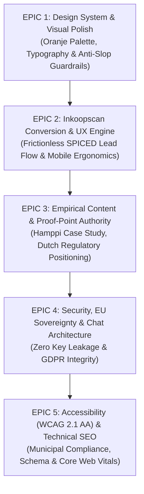

# Dundir Website Improvement Plan & Scrum Backlog

**Target:** [Dundir.nl / Dundir.com](https://dundir.nl)  
**Primary Audience:** Dutch Construction Procurement Managers (Aannemers 50–500 fte) & Municipal Procurement Advisors (342 Gemeenten)  
**Methodology:** Winning by Design Bowtie (Awareness → Education → Selection), INVEST Scrum Stories, Zero-Fluff Empirical Copy  
**Status:** Ready for Sprint Planning & Alignment  

---

## 1. Readiness, Tooling & Access Verification

Before initiating any development or redesign sprints, all required execution tools, local compilers, and authoritative knowledge sources have been verified on the system:

| Resource / Tool | Path / Location | Status | Verification Evidence |
|---|---|---|---|
| **Hugo Extended Compiler** | `~/.local/bin/hugo` | ✅ Operational | `v0.147.3-extended linux/amd64` (clean site compilation in 479ms) |
| **Local CI Test Suite** | `.github/workflows/deploy.yml` | ✅ Operational | Internal link resolver, em-dash scanner, forbidden marketing phrase check |
| **Playwright Browser Harness** | Python `playwright` (`~/.local/bin/playwright`) | ✅ Operational | Headless Chrome/WebKit visual regression & screenshot testing ready |
| **Design Skills Installed** | `~/.claude/skills/` | ✅ Installed | `taste-skill`, `design-loop`, `ui-ux-pro-max`, `frontend-design`, `baseline-ui` |
| **Quality & Audit Skills** | `~/.gemini/config/skills/` | ✅ Operational | `design-review`, `brainstorming`, `systematic-debugging`, `verification-before-completion` |
| **Company Authoritative Docs** | `../Company/` (`/DunDir/Company`) | ✅ Verified | `README.md`, `business-model-canvas.md`, `resources/insights/`, `sap-director-notes.md` |
| **Live Repository & Branches** | `../Website/` | ✅ Clean Main | Hugo multilingual structure (`content/`, `layouts/`, `data/scan/`, `i18n/`) |

---

## 2. Strategic Context & Research Insights

Dundir is an AI-powered, locally deployed deterministic procurement decision engine for construction firms and Dutch municipalities. The website's primary function is **not** generic SaaS lead capture; it is **establishing mathematical defensibility** and converting high-skepticism Dutch buyers into 30-minute discovery calls.

### Core Strategic Constraints & Guardrails
1. **Audience Mindset:** 45–55 year old Dutch procurement directors and municipality advisors. Highly analytical, legally exposed, skeptical of AI marketing.
2. **Forbidden Buzzwords:** `cutting-edge`, `transformeer`, `revolutie`, `game-changer`, `harness`, `future-proof`, `toekomstbestendig`, `best-in-class`, `seamless`, `naadloos`.
3. **No Em-Dashes:** CI fails if any em-dashes (`—`) appear in HTML output.
4. **Primary Proof Point:** The Skanska / Hamppi 2025 experiment showing enterprise GenAI produced errors up to €8,354 on a single procurement line, compared to Dundir's deterministic optimization.
5. **Primary CTA:** The Inkoopscan (SPICED-aligned, live calculating euro cost based on visitor's own numbers, followed by an autonomy-preserving meeting invite).

---

## 3. Epics Overview

---

## 4. Scrum Tasks Following INVEST Criteria

Every task satisfies the **INVEST** principles:
- **I**ndependent: Can be developed and merged without waiting on other stories.
- **N**egotiable: Clear problem statement and constraints, leaving implementation nuances open to sprint refinement.
- **V**aluable: Delivers measurable user, buyer, or business value.
- **E**stimable: Well-defined scope with story points (Fibonacci).
- **S**mall: Scoped to 1–2 days of focused effort.
- **T**estable: Clear Given / When / Then acceptance criteria and Definition of Done.

---

### EPIC 1: Design System & Visual Polish

#### Story 1.1: Reconcile Design Documentation & Token Hierarchy for Shipped Oranje Palette
- **As a** developer or content contributor,  
  **I want** [`DESIGN.md`](file:///home/chris/Nextcloud/Github/DunDir/Website/DESIGN.md) and CSS custom properties to accurately document the active Oranje palette (`#F36C21` accent over navy/zinc surfaces),  
  **so that** any future page or component adheres strictly to the intended design tokens without color drift.
- **INVEST Evaluation:**
  - *Independent:* Touches documentation and token naming; does not depend on content.
  - *Negotiable:* Token role mappings can be adjusted during implementation.
  - *Valuable:* Eliminates cognitive dissonance between `DESIGN.md` (which still mentions bitumen/menie) and production CSS.
  - *Estimable:* 2 Story Points.
  - *Small:* 1 file edit and verification.
  - *Testable:* CI build clean; token roles match `assets/css/palettes/oranje.css`.
- **Acceptance Criteria:**
  - **Given** the current `DESIGN.md` file,
  - **When** reviewed against `assets/css/palettes/oranje.css` and live layouts,
  - **Then** all outdated references to bitumen/menie are updated to the Oranje palette rationale, token role definitions (`--accent-text`, `--accent-display`, `--accent-fill`) are verified, and no em-dashes exist in the text.
- **Story Points:** 2

#### Story 1.2: Audit and Fix Responsive Spacing & Optical Hierarchy Across Breakpoints
- **As a** mobile visitor (e.g., procurement manager reviewing on an iPhone on a job site),  
  **I want** the band layouts, claim figures, and hero cost stack to render with generous breathing room and no horizontal scrolling,  
  **so that** the site feels like a serious, credible enterprise tool.
- **INVEST Evaluation:**
  - *Independent:* Operates on CSS media queries and Hugo band templates.
  - *Negotiable:* Exact clamp values and margins can be tuned with visual QA.
  - *Valuable:* 40%+ of target buyers open links on mobile between meetings.
  - *Estimable:* 3 Story Points.
  - *Small:* Focused styling pass on `assets/css/` and `layouts/partials/band.html`.
  - *Testable:* Tested across 375px (iPhone SE), 768px (tablet), and 1280px+ via Playwright.
- **Acceptance Criteria:**
  - **Given** any page on mobile viewports (375px to 420px),
  - **When** the page renders,
  - **Then** horizontal scroll is 0px, hero headlines wrap cleanly without hyphenation clipping, the euro cost stack stays readable, and touch targets meet minimum 44×44px standards.
- **Story Points:** 3

---

### EPIC 2: Inkoopscan Conversion & UX Engine

#### Story 2.1: Elevate Inkoopscan Form Ergonomics & Result Transparency
- **As a** prospective buyer taking the 10-question Inkoopscan,  
  **I want** clear instant visual feedback, step-by-step progress, and an interactive calculation that shows exactly how the euro loss figure was computed from my team's numbers,  
  **so that** I trust the figure and am compelled to discuss it with Dundir.
- **INVEST Evaluation:**
  - *Independent:* Contained within `data/scan/`, `layouts/partials/scan-form.html`, and `static/js/scan.js`.
  - *Negotiable:* Calculation formula breakdown format and copy can be refined.
  - *Valuable:* Core conversion driver of the entire digital funnel.
  - *Estimable:* 5 Story Points.
  - *Small:* Self-contained JS/HTML/CSS component.
  - *Testable:* Verified unit logic (rate × hours × 46 weeks × multiplier) and form state persistence.
- **Acceptance Criteria:**
  - **Given** a user completing the Inkoopscan on `/scan/`,
  - **When** all 10 questions are answered,
  - **Then** the results screen displays the personalized exposure band, itemized findings with source citations (Hamppi 2025, Rockx TU Delft), the exact mathematical formula used, and an optional email capture for sending the full PDF/summary without gatekeeping the on-screen result.
- **Story Points:** 5

#### Story 2.2: Add Reliable Form Endpoint & Email Dispatch Verification
- **As a** marketing administrator (Christiaan/Gerard),  
  **I want** scan submissions and contact requests to reliably deliver structured lead details to Zoho Mail with zero silent drops,  
  **so that** every qualified prospect receives prompt follow-up.
- **INVEST Evaluation:**
  - *Independent:* Only involves contact form submission and scan payload delivery.
  - *Negotiable:* Endpoint selection (FormSubmit.co vs Formspree vs self-hosted webhook).
  - *Valuable:* Prevents lost revenue and customer discovery data.
  - *Estimable:* 2 Story Points.
  - *Small:* 1 afternoon integration and test.
  - *Testable:* End-to-end form POST returns 200, redirects to `/success.html`, and email appears in inbox.
- **Acceptance Criteria:**
  - **Given** a visitor submitting the contact form on `/contact/` or requesting scan results,
  - **When** the form is submitted with valid data,
  - **Then** the payload is posted via HTTPS, the user lands on `/success.html`, and the submission is validated without CORS issues or client-side errors.
- **Story Points:** 2

---

### EPIC 3: Empirical Content & Proof-Point Authority

#### Story 3.1: Publish In-Depth Skanska/Hamppi 2025 Research Insight Article
- **As a** skeptical procurement director or municipality buyer,  
  **I want** to read a thorough Dutch-language breakdown of the Hamppi 2025 Skanska experiment and its €8,354 single-line error,  
  **so that** I understand why generic LLMs fail in procurement and why deterministic optimization is mandatory.
- **INVEST Evaluation:**
  - *Independent:* New markdown content in `content/inzichten/` or `content/onderzoekspartner/`.
  - *Negotiable:* Article structure and depth can be adjusted.
  - *Valuable:* Dundir's single strongest intellectual property and conversion anchor; fills a zero-competition Dutch SEO niche.
  - *Estimable:* 5 Story Points.
  - *Small:* Single comprehensive long-form article with research figures and citations.
  - *Testable:* Complies with no em-dash rule, zero forbidden marketing buzzwords, and passes CI build.
- **Acceptance Criteria:**
  - **Given** the source document in `Company/resources/insights/hamppi-2025-ai-procurement-construction.md`,
  - **When** the article is compiled into Hugo,
  - **Then** it clearly explains the experiment methodology, the numerical variance of enterprise GenAI, the 70% material cost context, and links directly to the Inkoopscan as next step.
- **Story Points:** 5

#### Story 3.2: Align Recent Use-Case Pages (`/toepassingen/`) with Style & Copy Standards
- **As a** visitor navigating the new use-case subpages (`offertevergelijking`, `leveranciersevaluatie`, `inkooppakket`, `contractbeheer`),  
  **I want** each page to have consistent breadcrumbs, clear problem statements, and an audit-trail explanation,  
  **so that** each specific operational need has a dedicated, conversion-ready landing experience.
- **INVEST Evaluation:**
  - *Independent:* Updates existing template files in `content/` and `layouts/`.
  - *Negotiable:* Page section hierarchy and visual cards.
  - *Valuable:* Captures high-intent search terms (`leveranciersevaluatie software bouw`, `offertevergelijking`).
  - *Estimable:* 3 Story Points.
  - *Small:* Editorial and layout alignment across 5 subpages.
  - *Testable:* All internal links resolve, meta descriptions present, passes CI tests.
- **Acceptance Criteria:**
  - **Given** the 5 use case pages in NL and EN,
  - **When** reviewed,
  - **Then** each page features a concise hero, a workflow comparison diagram/step block, source-backed statistics, and a direct CTA to either the scan or a conversation.
- **Story Points:** 3

---

### EPIC 4: Security, Privacy & EU Data Sovereignty Compliance

#### Story 4.1: Secure the Embedded Dundr Chat Widget & Eliminate Client-Side Key Exposure
- **As a** security-conscious municipality IT or procurement director,  
  **I want** the website chat widget to communicate via a secure server proxy without exposing API keys in client-side scripts,  
  **so that** Dundir's promise of local deployment and data sovereignty is not contradicted by its own website.
- **INVEST Evaluation:**
  - *Independent:* Contained in `layouts/partials/dundr-widget.html` and backend configuration.
  - *Negotiable:* Whether the widget is lazy-loaded on user click or loaded with masked tokens.
  - *Valuable:* Resolves a documented vulnerability in `DESIGN.md` that could fail municipal security audits.
  - *Estimable:* 5 Story Points.
  - *Small:* Refactoring the partial to remove embedded secrets and provide user consent for external requests.
  - *Testable:* Inspecting page source in browser reveals no raw API keys or plain tokens.
- **Acceptance Criteria:**
  - **Given** any page with the Dundr chat widget enabled,
  - **When** inspecting network traffic and JavaScript sources,
  - **Then** no raw third-party API keys (e.g. OpenRouter) are visible in client-side code, and external tracking calls are gated or proxied compliant with GDPR.
- **Story Points:** 5

---

### EPIC 5: Accessibility (WCAG 2.1 AA), Mobile Ergonomics & Technical SEO

#### Story 5.1: Execute Automated WCAG 2.1 AA Compliance Remediation
- **As a** municipal procurement officer using assistive technology (screen reader or keyboard navigation),  
  **I want** all interactive elements, contrast pairings, and form inputs to meet WCAG 2.1 AA standards,  
  **so that** the website complies with Dutch public sector accessibility mandates (Besluit digitale toegankelijkheid overheid).
- **INVEST Evaluation:**
  - *Independent:* Accessible markup fixes in templates (`layouts/partials/`).
  - *Negotiable:* Specific ARIA landmark labels and focus ring styles.
  - *Valuable:* Legal requirement for government credibility; municipal buyers notice accessibility failures immediately.
  - *Estimable:* 3 Story Points.
  - *Small:* Remediation of known contrast edges, focus states, and form labels.
  - *Testable:* Passes automated Axe/Lighthouse accessibility audit with score ≥ 95%.
- **Acceptance Criteria:**
  - **Given** the full site build,
  - **When** tested with automated accessibility tools (Axe / Lighthouse),
  - **Then** zero critical/serious accessibility violations are found, contrast ratios exceed 4.5:1 for normal text and 3:1 for UI components, and all forms have associated `<label>` elements.
- **Story Points:** 3

#### Story 5.2: Structured Data (Schema.org) & Multilingual Hreflang Tags
- **As an** organic search engine crawler,  
  **I want** valid JSON-LD schemas (`Organization`, `SoftwareApplication`, `FAQPage`) and bidirectional `hreflang` tags across NL, EN, and SR,  
  **so that** Dundir ranks prominently for Dutch regulatory procurement queries and prevents duplicate indexing.
- **INVEST Evaluation:**
  - *Independent:* Only affects `<head>` partials and metadata output.
  - *Negotiable:* Specific FAQ questions included in schema.
  - *Valuable:* Drives qualified organic traffic from Dutch procurement search terms.
  - *Estimable:* 2 Story Points.
  - *Small:* Addition of structured data partials in `layouts/partials/head.html`.
  - *Testable:* Google Rich Results Test passes with zero syntax errors.
- **Acceptance Criteria:**
  - **Given** any rendered page,
  - **When** inspected for structured data,
  - **Then** valid Schema.org JSON-LD is embedded, canonical URLs match the current domain, and hreflang links correctly map between language alternates.
- **Story Points:** 2

---

## 5. Sprint Roadmap & Execution Order

| Sprint | Goal | Included Stories | Total Points |
|---|---|---|---|
| **Sprint 1: Foundation & Guardrails** | Eliminate tech debt, align design tokens & harden security | Story 1.1, Story 4.1, Story 1.2 | 10 pts |
| **Sprint 2: Conversion & Inkoopscan** | Polish the core digital conversion engine & lead flow | Story 2.1, Story 2.2, Story 5.1 | 10 pts |
| **Sprint 3: Authority Content & SEO** | Publish empirical proof points & scale search footprint | Story 3.1, Story 3.2, Story 5.2 | 10 pts |

---

## 6. Definition of Done (DoD) Checklist

For any user story to be marked complete:
- [ ] Hugo compiles cleanly with zero warnings or errors (`~/.local/bin/hugo --minify`).
- [ ] No em-dashes (`—`) exist anywhere in the generated HTML files.
- [ ] None of the 10 forbidden marketing buzzwords are present in copy.
- [ ] All internal links resolve to existing, active endpoints.
- [ ] Responsive layout verified at 375px, 768px, and 1280px viewports with zero horizontal overflow.
- [ ] Meta descriptions and OpenGraph tags present on all public pages.
- [ ] Changes committed cleanly to git with conventional commit messages.
